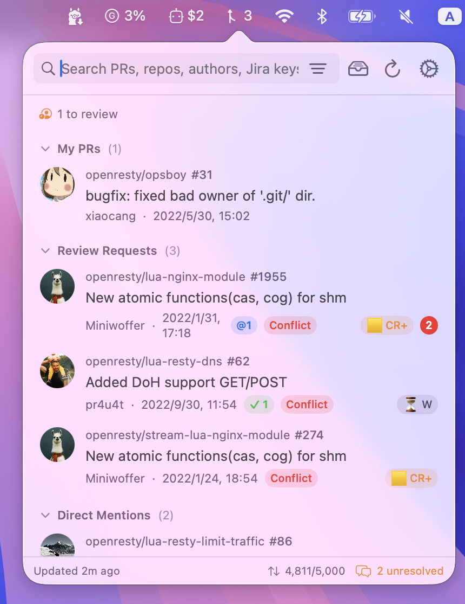
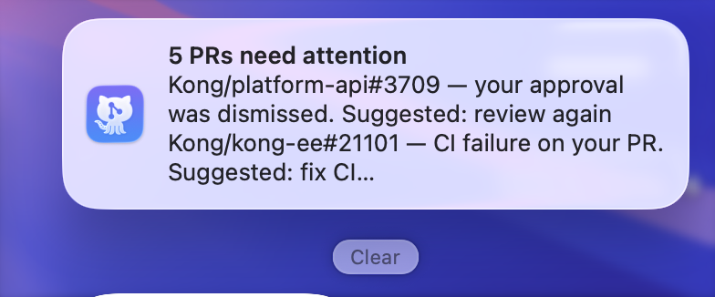
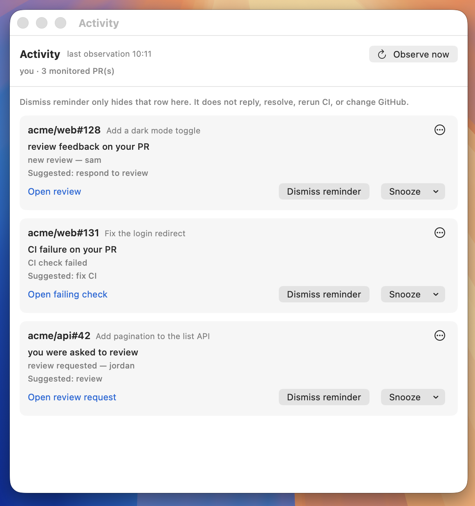

# PR Dashboard

A Mac menu bar app for the GitHub pull requests that involve you.

Open the icon next to the clock. You see PRs you opened, PRs waiting on your review, and PRs that mention you, without keeping a GitHub tab open. Leave it running and it sends at most one short reminder when a review, a comment, or a failing check actually needs you.

It does not replace GitHub, and it is not a bot on GitHub's servers. You still review, comment, and merge there. This app reads and reminds. It changes GitHub only when you click.

The app is **PR Dashboard**. This repository is [`kong/ghpr-view`](https://github.com/kong/ghpr-view). The local command is `ghpr`.




## Highlights

**Your PRs, next to the clock.** Authored PRs, review requests, and mentions in one popover. CI and unresolved comments show on the row.

**A reminder only when it matters.** The first look at a PR is silent, so an old backlog is not replayed as news. After that, at most one digest every 30 minutes, and only when something new needs you. It can go to a Mac notification, a Slack DM to yourself, or both. Activity says why each item concerns you. Dismiss, snooze, and mute affect the reminder only. The app does not review, comment, or rerun CI for you, and it only watches while this Mac is awake and the app is running.





**It stays on this Mac.** There is no account on our side. If you want the same list somewhere else, a userscript can add a small ghpr menu on a GitHub PR page, and the local `ghpr` command can answer a coding agent. Neither one submits a review to GitHub.

## Install

```bash
brew install xiaocang/tap/prdashboard
```

Or download the latest [release](https://github.com/kong/ghpr-view/releases), unzip it, and move `PRDashboard.app` to Applications. The first open may need a right-click → Open.

No Dock icon, unless you open Activity or Settings.

## Sign in

Click the menu bar icon, then **Sign in with GitHub**, and enter the code at [github.com/login/device](https://github.com/login/device).

If that is blocked, use a [personal access token](https://github.com/settings/tokens) with `repo`, `read:user`, `workflow`, and `read:org`. A release build keeps it in the Keychain.

Left-click opens the list. Right-click opens the menu, including Quit. Search, Filter, and Refresh are at the top; a compact All / My PRs / Reviews / Mentions selector scopes the list below it. All retains the five existing role sections, including recently merged PRs; Mentions keeps ordinary and direct mentions separate. Search and facet filters remain active when switching categories. Activity and Settings are in the footer. Each PR has a Details button for the full status and available actions.

The Filter button and selected category use native Glass on macOS 26 and later. Search remains an NSSearchField with its native semantic bezel. The selected category applies Glass to the complete label with semibold, primary hierarchical text, allowing the system to adapt both the material and foreground contrast. Reduce Transparency and older systems use an opaque system control background; Increase Contrast adds a stronger edge. The category highlight moves over 240ms; Reduce Motion removes that custom transition.

**Cmd+F** focuses search, **Cmd+R** refreshes, and **Cmd+,** opens Settings. With the list focused, use the arrow keys to select a PR and Return to open it. Escape clears a search before closing the panel; native menus, sheets, and input composition handle Escape first. Clearing search keeps your selected filters.

The CI summary includes both failed and unknown checks; individual rows distinguish them. The menu bar count combines unread unresolved threads on your PRs with unanswered direct mentions. Activity has its own reminder count.

The footer shows only the API pool with the lower remaining percentage (REST or GraphQL). Hover it to see both pools and their reset times; the Synchronization details popover also lists both. Unknown pools remain visibly unavailable rather than being combined or inferred.

Settings uses a persistent sidebar for General, Pull Requests, Alerts, Integrations, and Advanced, with Cancel/Save controls. Its 620×620pt minimum content size and 156pt sidebar preserve readable form space; the menu panel remains 400×500pt. Switching pages keeps your draft. Sign-in, connections, and Launch at Login take effect immediately; Cancel discards the remaining draft settings.

Jira keys use a light accent marker and open independently from the PR row. Hovering a key or status badge shows a short explanation; the row's Details button and title hover still provide the full PR context. The last-commit time tooltip triggers only from the time label, not anywhere across the row. Pending explanations are cancelled when the panel closes or their content is replaced. Activity and Settings use borderless footer icons.

Clicking a digest notification opens Activity with that digest's local history. If its history has expired, Activity explains that and still shows current reminders. Dismiss and Snooze keep the reminder visible if saving fails. Snooze's 24 hours and 7 days are elapsed durations.

## Requirements

macOS 13 or later, and a GitHub account. The interface is in English and Simplified Chinese.

## Build from source

Building the native app requires Xcode 26 or later with the macOS 26 SDK or later. The app still runs on macOS 13 and later; older systems use standard bordered controls.

```bash
git clone https://github.com/kong/ghpr-view.git
cd ghpr-view
./run.sh
```

`make build-cli` builds `ghpr`. `make install-mcp` is optional and needs Node.js. See [`mcp-ghpr/README.md`](mcp-ghpr/README.md).

## Security

Credential storage, the local socket, and the browser bridge are described in [SECURITY.md](SECURITY.md). Report a vulnerability there, not in a public issue.

## License

Apache License 2.0. See [LICENSE](LICENSE).

## Contributing

Issues and pull requests are welcome at [`kong/ghpr-view`](https://github.com/kong/ghpr-view/issues).
